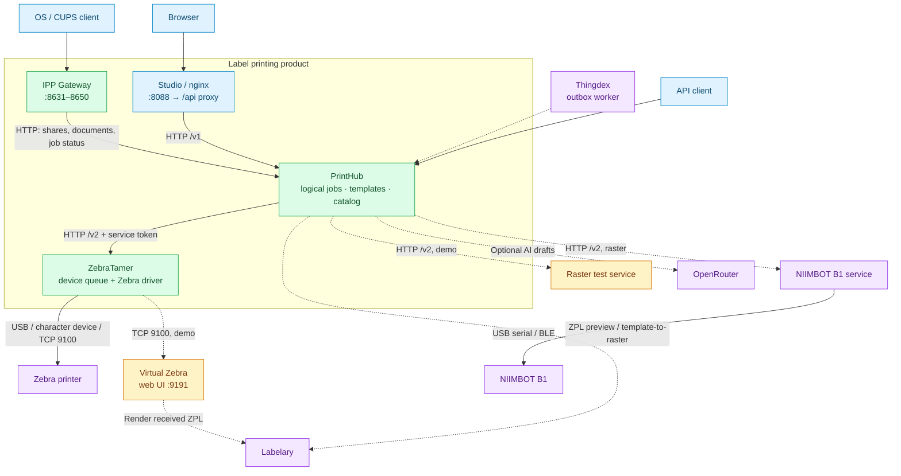
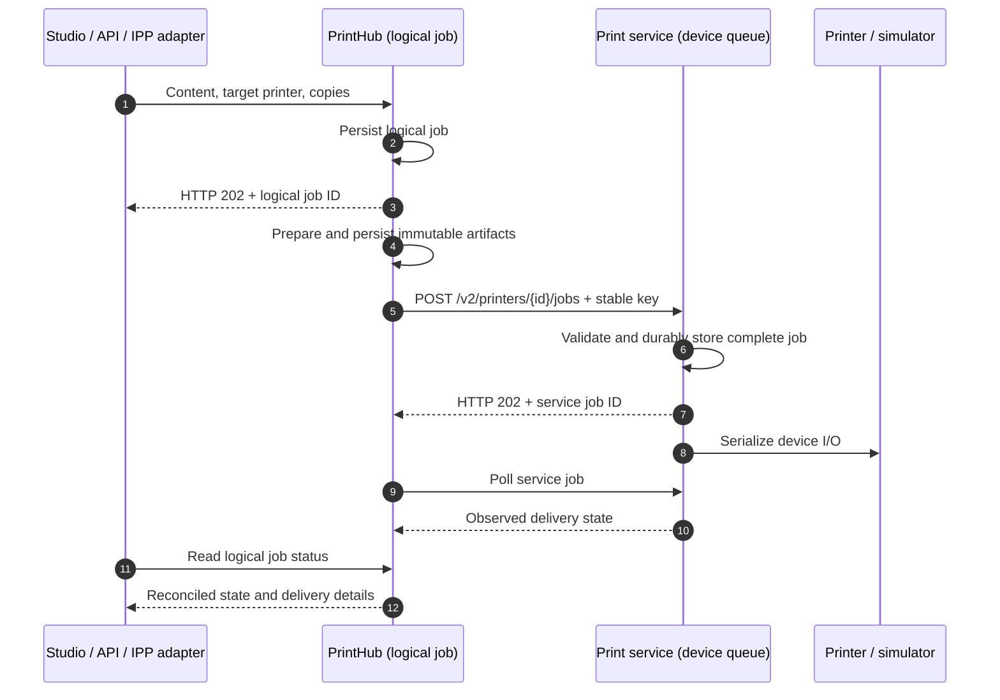

# PrintHub Label Printing

Design labels in Studio, print through the PrintHub API or an operating-system
IPP queue, and deliver them through a service that owns the printer. This
repository assembles the components and their configuration; it contains the
installer and the optional NIIMBOT driver, while the main applications are
pinned Git submodules. Thingdex is an optional inventory integration.

## Projects and responsibilities

| Project / location | Responsibility | Boundary |
| --- | --- | --- |
| **Labeldrucker** (this repository) | Compose stack, installer, configuration, product CI and release assembly | Coordinates deployment; the main application code lives in submodules. |
| [**LabelArchitect → PrintHub Studio**](https://github.com/Hartmannlight/LabelArchitect) | Browser UI for templates, Quick print, Image designer, jobs, printer services, media and IPP shares | One application combining the former editor and LabelGallery workflows. Browser bitmap designs remain separate from the server's ZPL template library. |
| [**PrintHub-ZPL-ll**](https://github.com/Hartmannlight/PrintHub-ZPL-ll) (`zplgrid`) | Templates, ZPL compilation, document/raster preparation, logical jobs, public printer catalog and IPP share registry | Calls print services over HTTP; printer transport and vendor commands belong to those services. |
| [**ZebraTamer**](https://github.com/Hartmannlight/ZebraTamer) (`zpl-agent` binary) | Durable Zebra queue, device settings, observed status, media accounting; character device, USB bulk and RAW TCP transports | Converts prepared raster pixels to Zebra `^GF`. It is a TCP client, with no RAW-9100 listener or CUPS/IPP server. |
| **IPP Gateway** (`components/PrintHub-ZPL-ll/ipp-gateway`) | Driverless OS/CUPS input, one listener per share, persistent IPP ↔ PrintHub job mapping | A separate runtime image from the PrintHub repository. Submits documents to PrintHub rather than driving hardware. |
| [**printhub-sdk**](https://github.com/Hartmannlight/printhub-sdk) | TypeScript client and types for the PrintHub OpenAPI contract | Private workspace package used by Studio; no runtime service or standalone container. |
| **NIIMBOT service** (`services/niimbot`) | Durable SQLite raster queue and one device worker for B1 over USB serial or BLE | Optional local build; B1 Pro and other models are unsupported. See [B1 setup](docs/NIIMBOT.md). |
| [**ZPL-II-Printer-Emulator**](https://github.com/Hartmannlight/ZPL-II-Printer-Emulator) | Demo RAW-9100 receiver, Labelary rendering and recent-output web UI | Simulates received label output; does not prove device status, calibration or physical printing. |
| **Raster test service** (`components/PrintHub-ZPL-ll/simulators/raster-print-service`) | Demo/conformance implementation of the common raster print-service contract | Stores simulated output; it is not a NIIMBOT driver. |
| [**Thingdex**](https://github.com/Hartmannlight/Thingdex) | Optional inventory backend; its outbox worker submits label requests to PrintHub | Inventory and its database stay outside this product's Compose stack. |
| [**Thingdex-Home-Inventory**](https://github.com/Hartmannlight/Thingdex-Home-Inventory) | Overview of the wider inventory ecosystem | Documentation, no runtime service. Its pinned overview contains legacy Fleet/LabelGallery architecture; use the diagram below for this stack. |

### Who talks to whom?

Solid arrows show the core runtime path; dashed arrows show optional integrations
and demo services. The SDK is bundled into Studio, not deployed between services.



Ports shown are host defaults. Container-to-container calls use service names:
`printhub:8000`, `zebratamer:8080`, `niimbot:8080` and `raster-test:8080`.
The virtual printer's TCP 9100 port is internal to Compose; only its web UI is
published. All published ports bind to loopback by default. For a real LAN
Zebra, add the [required outbound network](docs/INSTALLATION.md#ethernet-zebra-and-outbound-networking).

### Two queues, two different acknowledgements



The sequence shows the default background-job mode. HTTP acceptance is queue
acceptance. `transport_accepted` means bytes reached the transport;
`confirmed` requires observed completion from the service. Simulator completion
is evidence of simulated output. `unconfirmed` / service `outcome_unknown`
requires inspection before a deliberate reprint; it is never automatically
replayed as a new physical job.

| Input | Preparation | Labelary needed? |
| --- | --- | --- |
| ZPL template → native Zebra output | PrintHub compiles ZPL; ZebraTamer transmits it | No for printing; enabled previews call Labelary separately. |
| ZPL template → raster-only target, or **Rendered image** mode | PrintHub renders the complete resolved ZPL to pixels | Yes, independently of the three preview switches. |
| Image designer → PNG | Browser canvas at printer DPI → PrintHub raster preparation → device driver | No. |
| PDF/image/IPP document | Local PrintHub document rasterization → device driver | No. |
| Received ZPL → emulator web image | The emulator calls Labelary | Yes, independently of PrintHub's preview switches. |

## Start

Requirements: Docker Engine with a current Compose plugin (`docker compose`;
v2 or newer). Published AMD64/ARM64 images are the defaults, so the core stack
needs no application source build. Keep the Compose files, `setup/`,
`.env.example` and `config/` together.

Run the one-time setup container from the repository directory. It guides you
through LAN access, printers, label stock, IPP, preview settings and an optional
OpenRouter model. It writes `.env` and a local installation manifest without
requiring the application services to be running.

```bash
docker compose --profile setup run --rm --no-deps setup
docker compose up -d
```

The setup container itself has no Docker socket; starting it still requires
access to the host Docker daemon. Keep `setup/`, `.env.example` and `config/`
alongside the Compose files when copying this installation to another host.

The short-lived `config-apply` service registers the chosen printers, media and
IPP shares after PrintHub is healthy. For a printer attached to a Linux host by
USB, use the [USB startup command](docs/INSTALLATION.md#docker-on-a-64-bit-raspberry-pi-with-usb-zebra)
instead of the second command. The device must be present and accessible to
the container user. For Ethernet, see the outbound-network requirement above.
The full [installation guide](docs/INSTALLATION.md) covers
manual and advanced settings.

Initialize the four product submodules only when building or developing the
images locally:

```bash
git submodule update --init components/PrintHub-ZPL-ll components/printhub-sdk components/LabelArchitect components/ZebraTamer
docker compose build
```

Open [http://localhost:8088](http://localhost:8088) or the address chosen in
setup. The printer list starts with any printers entered in the wizard; more can
be added in **Printers**. Read the generated PrintHub admin token with:

```bash
docker compose run --rm --no-deps bootstrap cat /secrets/printhub-admin-token
```

The API is at [http://localhost:8001/docs](http://localhost:8001/docs) and the
standalone ZebraTamer UI at [http://localhost:8082/ui/](http://localhost:8082/ui/).
All web ports bind to loopback by default.

## Start without a physical printer

The demo adds a virtual RAW-9100 Zebra and a raster-only conformance service.
Their default images are local `candidate:*` tags, so build these two services
before starting; the four core services can use their published images:

```bash
git submodule update --init components/PrintHub-ZPL-ll components/ZPL-II-Printer-Emulator
docker compose -f compose.yaml -f compose.demo.yaml --profile demo build virtual-zebra raster-test
docker compose -f compose.yaml -f compose.demo.yaml --profile demo up -d --no-build --wait --wait-timeout 240
```

Open Studio and select **Virtueller Zebra** (`virtual-zebra`). In **Printers**,
load a 50 × 25 mm roll before printing; the seeded device profile is 203 dpi.
An installation manifest can also load media through `config-apply`. The demo
TOML seeds the printer, not its loaded roll. See received labels at
[http://localhost:9191](http://localhost:9191).

The demo overlay forces all three PrintHub Labelary preview switches to `1`,
even if `.env` says `0`. Both PrintHub previews and emulator images send resolved
ZPL to Labelary. The emulator retains recent jobs in memory, so restarting it
clears its history. Use demo files/profile consistently for subsequent starts,
logs and configuration changes. For a fully local bitmap workflow, use Image
designer with the raster test service; emulator image rendering still needs
Labelary. [Development](docs/DEVELOPMENT.md) covers building all components.

## Documentation

- [Installation and printer setup](docs/INSTALLATION.md)
- [Template library and AI assistant](docs/TEMPLATE_ASSISTANT.md)
- [Architecture](docs/ARCHITECTURE.md)
- [Operations, backup and migration](docs/OPERATIONS.md)
- [Release candidate installation](docs/RELEASE.md)
- [Development and print-service extension](docs/DEVELOPMENT.md)
- [Dated simulator acceptance evidence](docs/acceptance/REFACTORING_2026-09-08.md)
- [Raspberry Pi 3A USB hardware acceptance](docs/acceptance/PI3A_USB_2026-09-08.md)
- [Completion audit by work package](docs/implementation/COMPLETION_AUDIT_2026-09-08.md)
- [Detailed refactoring work packages](docs/REFACTORING_ARBEITSPAKETE.md)
- [Documentation review and known implementation gaps](docs/DOCUMENTATION_REVIEW.md)

Acceptance records describe their recorded revisions and topology. They do
not establish that the current images, every printer model or every LAN setup
have passed those same checks.
